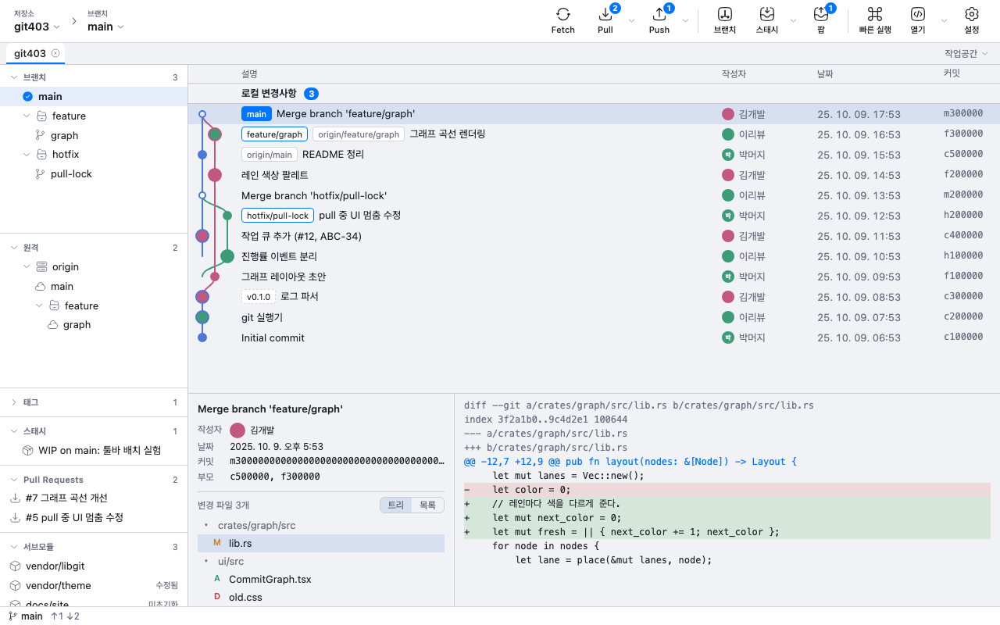

<p align="center">
  
</p>

<h1 align="center">git403</h1>

<p align="center">가볍고 빠른 크로스플랫폼 git 클라이언트</p>

<picture>
  <source media="(prefers-color-scheme: dark)" srcset="docs/images/screenshot-dark.png">
  
</picture>

## 특징

- **빠르다**: Rust 코어와 Tauri 2로 만들었습니다. 설치 파일은 약 10MB이고, Electron 앱보다 메모리를 훨씬 적게 씁니다.
- **보기 좋은 그래프**: 브랜치마다 색을 달리한 커밋 그래프에 작성자의 GitHub 프로필 사진을 함께 보여 줍니다.
- **크로스플랫폼**: macOS, Windows, Linux를 지원합니다.
- **라이트·다크 테마**: OS 설정을 따르고, 강조색을 고를 수 있습니다.
- **VS Code 확장**: 같은 커밋 그래프를 VS Code 안에서 쓸 수 있습니다.

## 기능

| 분류 | 내용 |
|---|---|
| 변경·커밋 | 파일·hunk·줄 단위 스테이지, 변경 되돌리기, 커밋, amend, reword |
| 브랜치 | 체크아웃·생성·삭제·이름 변경·추적, 원격 브랜치 삭제, 태그, 그래프에서 브랜치 숨기기 |
| 원격 | Pull·Push·Fetch 옵션, 원격 관리, 인증, ahead/behind 표시 |
| 히스토리 편집 | merge, rebase, interactive rebase, cherry-pick, revert, reset, 충돌 해결 화면 |
| 스태시 | 만들기(부분 포함)·적용·pop·삭제·이름 변경 |
| 탐색 | 메시지·작성자·SHA·내용 검색, 파일 히스토리, blame, 커밋 시점 파일 보기 |
| 저장소 | clone, init, 저장소 탭, 작업공간, 서브모듈, worktree, Git LFS, git-flow |
| 도구 | 패치·스냅샷, 사용자 정의 명령, 외부 diff/merge 도구, 터미널·파일 탐색기 열기, 저장소 통계 |
| 호스팅 연동 | GitHub·GitLab·Bitbucket·Gitea 계정, PR 만들기, 이슈 링크 |
| AI (선택) | 커밋 메시지, 코드 리뷰, 충돌 도우미, PR 설명. 사용자 API 키나 CLI가 있을 때만 보입니다. |

## 설치

설치 파일은 [Releases](https://github.com/goldtagworks/git403/releases)에 있습니다. macOS는 Homebrew로 설치합니다: `brew tap goldtagworks/git403 https://github.com/goldtagworks/git403 && brew install --cask git403`. 설치한 뒤에는 앱이 자동으로 업데이트됩니다. 소스에서 설치하려면 아래처럼 하세요.

git이 설치되어 있어야 합니다. 없으면 앱이 설치 방법을 안내합니다.

### VS Code 확장

VS Code 마켓플레이스에서 `git403`(`goldtagworks.git403`)을 검색해 설치하세요. 명령 팔레트에서 `git403: Open Commit Graph`로 그래프를 엽니다.

- 커밋 그래프: 파일·hunk·줄 단위 스테이지, merge, rebase, cherry-pick, 충돌 해결
- 인라인 blame과 hover (`git403: Toggle Inline Blame`)
- 사이드바 뷰: 브랜치, 태그, 스태시, 원격, 파일 히스토리, 줄 히스토리
- CodeLens, 파일·줄 히스토리 diff

지원 플랫폼은 macOS(Apple Silicon)와 Windows x64입니다.

### 소스에서 설치

저장소를 받은 뒤 아래 파일을 더블클릭하세요. 필요한 도구(Rust, Node, pnpm 등)를 설치하고, 빌드한 다음, 앱을 설치합니다. 여러 번 실행해도 됩니다.

| OS | 설치 | 빌드만 |
|---|---|---|
| macOS | `install-mac.command` | `build-mac.command` |
| Windows | `install-windows.bat` | `build-windows.bat` |

빌드 결과물은 `out/` 폴더에 생깁니다.

## 개발

필요한 것: Rust(버전은 `rust-toolchain.toml`에 고정), Node 22 이상, pnpm, git

```sh
pnpm install && pnpm --dir ui install
pnpm dev                  # 개발 모드로 실행
pnpm build                # 릴리스 빌드 → out/
```

| 확인 | 명령 |
|---|---|
| Rust 테스트 | `cargo test --workspace` |
| 타입 검사 | `pnpm --dir ui build` |
| mock E2E (리렌더링·라이트/다크 스크린샷 포함) | `pnpm --dir ui e2e` |
| 실제 앱 E2E (디버그 빌드를 임시 저장소로 실행) | `pnpm --dir ui e2e:app` |
| VS Code 확장 빌드·테스트 | `pnpm --dir vscode build`, `pnpm --dir vscode test` |
| VS Code 확장 패키징 (VSIX) | `pnpm --dir vscode package` |

### 구조

```
crates/core      git 실행·출력 파싱
crates/graph     커밋 그래프 레이아웃
crates/hosting   GitHub·GitLab 등 호스팅 API
crates/ai        AI 연동
src-tauri        Tauri 앱 (IPC 명령·이벤트)
ui               React 화면, Canvas 그래프
vscode           VS Code 확장 (ui 빌드를 웹뷰로, git403-server를 백엔드로 사용)
```

### 기여하기 전에 볼 문서

- [docs/roadmap.md](docs/roadmap.md): 진행 상황
- [docs/reuse.md](docs/reuse.md): 재사용할 모듈과 IPC 목록
- [docs/performance.md](docs/performance.md): React 리렌더링 규칙
- [docs/design.md](docs/design.md): 디자인 규칙
- [docs/release.md](docs/release.md): 릴리스 방법

## 후원

git403은 유료 플랜이나 로그인 없이 무료입니다. 도움이 됐다면 [GitHub Sponsors](https://github.com/sponsors/goldtagworks)로 후원해 주세요.

## 라이선스

라이선스는 아직 정하는 중입니다.
